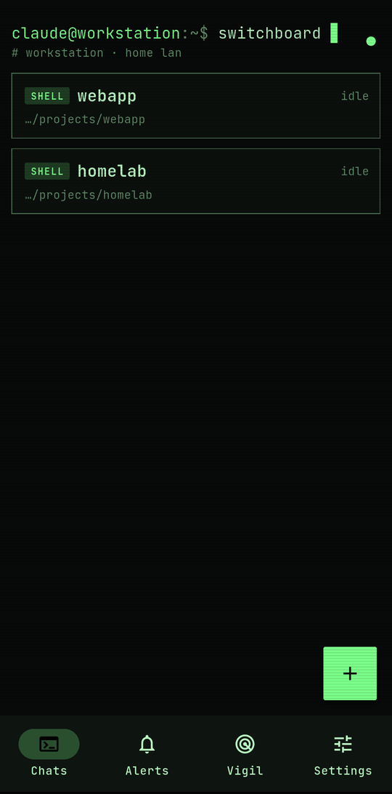
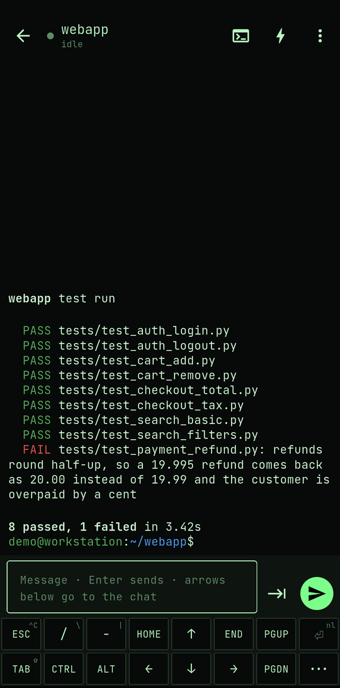

# Switchboard

**A phone switchboard for Claude Code.** An Android/desktop app plus a small bridge (we call it a **node**) on each
of your machines that let you drive [Claude Code](https://claude.com/claude-code) chats from your phone. It works
with the normal cloud `claude` and with Claude Code pointed at a local model (`claude-local`, e.g. Qwen through
llama.cpp). The app holds **several machines at once** — Linux (chats in **tmux**) and Windows (chats in
**sbkeeper**, native, no WSL) — so they survive dropped connections, and one machine being down only hides its own
chats. The phone gets **alerts** when a chat is done, needs permission or has a question, and tapping one opens the
app at that prompt with the answer buttons ready.

```
Phone / desktop (Flutter app) ──WSS, pinned self-signed TLS, per-device key──► one node per machine (Python)
   LAN at home / Tailscale away (auto), one connection per machine              ├─ Linux:  tmux session "AI", one window per chat
                                                                                ├─ Windows: sbkeeper holds ConPTY chats + scrollback
                                                                                ├─ Claude Code hooks → status + alerts
                                                                                ├─ Home Assistant push (optional) → deep links
                                                                                └─ optional reverse proxy for another LAN page (e.g. a dashboard)
```

<p>
  
  
</p>

## What it does

- **Several machines at once (1.3).** The app pairs with each machine separately and keeps one connection per
  machine. The chat list is **grouped by machine** with an online/offline header, alerts are tagged with the machine
  they came from, and a new chat picks the machine first, then the launcher. A machine that's offline just shows its
  chats greyed out — everything else keeps working. Manage them in **Settings → Machines** (add by QR scan or link,
  rename, forget).
- **Two ways to read a chat.** The **Reader** (default) re-flows the chat's text natively on the phone: long lines
  wrap to your screen, colours stay, you can select text, pinch to zoom, and rotating the phone never garbles anything.
  The **raw terminal** (xterm) shows the exact tmux screen and scrolls sideways when it's wider than the phone. Neither
  view resizes the real window, so a laptop attached to the same chat keeps its layout.
- **A Termux-style key bar** above the keyboard: ESC, TAB, CTRL, ALT, arrows, HOME/END, PGUP/PGDN, Enter and more.
  CTRL and ALT stay on for the next key (tap) or until you tap again (long-press), so CTRL then `c` sends Ctrl-C.
  Swipe up on a key for its second symbol. Plus a multi-line **composer** (sent as one paste, keyboard voice input
  works), a **slash-command palette**, and **photo upload**: the picture lands on the server and its path goes into
  your message.
- **Answer prompts with one tap.** When Claude asks for permission or uses its multiple-choice question tool, the
  bridge reads the real choices off the screen ("Yes / Yes, and always allow … / No") and shows them as buttons, on the
  chat list, in the chat, and in the alert. Tapping presses the matching number in the chat.
- **Persistent chats.** Everything runs in tmux on the server. Close the app, lose signal or switch networks, and the
  chat keeps going; reopen it and you're back. The same windows are there when you `tmux attach` from a laptop.
  Phones attach through their own grouped view session, so the laptop's current window doesn't jump around.
- **Alerts.** Claude Code hooks (`SessionStart`, `UserPromptSubmit`, `PreToolUse`, `PermissionRequest`,
  `PostToolUse`, `Notification`, `Stop`, `SessionEnd`) feed a small state machine: working → needs permission /
  question → done. While the app is open you get an in-app banner. When it's closed, the bridge pushes through the
  **Home Assistant companion app** (Firebase delivery, so you don't need to exempt Switchboard from battery
  optimisation). Tapping the notification opens `switchboard://alert/<id>`, and its buttons answer directly
  (`switchboard://answer/<id>/<choice>`).
- **New chats from the phone:** pick a machine, then `claude`, `claude-local` or a shell, and a folder.
- **Skins.** *Terminal* (green phosphor, default), *Material 1* (2014 paper and shadows), *Starship* (a bridge
  console with elbows and pills), *Galactic* (hologram blue and crawl yellow), *Neon Night* (cyberpunk), *Amber CRT*.
  All are drawn in code with open-licensed fonts (OFL). **Mascot packs:** drop your own pictures and lines into
  `app/assets/private/miko/` and up to four more skins appear (see below). That folder is git-ignored.

## Security model

- The bridge listens **only** on the addresses you give it (e.g. the LAN IP and the Tailscale IP), never `0.0.0.0`.
  Put it behind your LAN and/or Tailscale. **Do not port-forward it to the internet.** It is a shell on your machine.
- TLS uses a self-signed certificate. The app **pins its SHA-256** (from the pairing link/QR), so it trusts nothing else.
- **Per-device keys (1.3).** Each device pairs with each machine and gets **its own key**, so you can revoke one
  device without re-pairing the others (`switchboard devices`, or Forget in the app — a device revoking itself is
  just saying goodbye). The pairing link/QR carries a **one-time code** valid 10 minutes, not the access token, and
  pairing is rate-limited (wrong codes cost a delay; 5 wrong codes lock pairing for 10 minutes). The node stores
  only `sha256(token)` in `devices.json` (mode 600). The old shared token still works for apps older than 1.3 until
  you turn it off: `switchboard devices legacy off`.
- Hooks talk to the bridge on `127.0.0.1` with a separate key. They only report status: they never block or change what Claude does.
- New chats can only start in folders under `roots` (default: your home directory).

## Install the bridge (Linux)

Needs `tmux`, [`uv`](https://docs.astral.sh/uv/), `openssl`, Claude Code, and systemd user services.

```bash
git clone <this repo> && cd switchboard
deploy/install.sh --hosts 192.168.1.10,100.x.y.z          # your LAN IP, your Tailscale IP
# optional phone push via Home Assistant (token in ~/.ha_token):
#   --ha-url http://homeassistant.local:8123 --ha-notify mobile_app_my_phone
# optional page to show in the app's web tab:  --vigil-url http://192.168.1.20:30300
sudo loginctl enable-linger $USER                          # keep it running after you log out
switchboard pair                                           # one-time pairing code: link + QR to scan from the app
switchboard devices                                        # paired devices; revoke: switchboard devices revoke ID
```

`switchboard download-link` prints a link (valid 48 h) to a page that offers the APK (copy a build to
`~/.config/switchboard/switchboard.apk`) and the pairing link. The page opens once, because it shows the access token; the APK link keeps working until
the 48 h are up. `switchboard push on|off|test` controls phone push.

A `claude-local` chat runs `bash -ic 'claude-local'`, so define `claude-local` as a shell function or alias, e.g. one
that sets `ANTHROPIC_BASE_URL` to your local server and starts `claude`.

## Run a node on Windows (1.3)

The same Python program runs natively on Windows 11 (x64 or ARM64, no WSL). Chats live in **sbkeeper**, a small
long-lived process that holds ConPTY sessions with their own 50 000-line scrollback, so chats survive node
restarts and updates (a reboot still ends them, like tmux). From a repo copy, in an **elevated** PowerShell:

```powershell
powershell -ExecutionPolicy Bypass -File deploy\windows-node\install.ps1 -Hosts 192.168.1.20,100.x.y.z
```

That creates a venv, installs the node + keeper as per-user Scheduled Tasks (hidden, restart on failure), opens the
node port on the Private and Tailscale firewall profiles only, and adds the Claude Code hooks. Run it again to
update: config, devices and the cert are kept, and the keeper is restarted only when its file changed (restarting
it ends open chats). Pair from the node: `... \switchboard-node\venv\Scripts\python.exe \switchboard-node\switchboard.py pair`.
Full protocol details: [docs/NETWORK-PROTOCOL.md](docs/NETWORK-PROTOCOL.md).

## Build the app

Flutter 3.4x, Android SDK, JDK 17.

```bash
cd app
flutter test && flutter analyze
flutter build apk --release --split-per-abi      # signs with android/key.properties if present, else the debug key
```

Install the APK, then **Settings → Machines → Add a machine** and scan the QR from `switchboard pair` (or paste the
link; the desktop app has no scanner, so paste there). The app tries each machine's hosts in order (LAN first) and
switches to Tailscale automatically when you're away.

**Samsung / Android tips:** allow notifications for the Home Assistant app. Switchboard itself doesn't need to stay
awake, because push comes through Home Assistant.

## Mascot packs (optional, private)

Put `pro_<state>.webp`, `hood_<state>.webp`, `chibi_<state>.webp` and (for a dark chibi skin) `chibinight_<state>.webp`
(states: idle, working, done, permission, question, error, sleep; 384×384 works well, transparent background for
chibinight) plus a `lines.json` (`{"pro": {"done": ["{session} is done."], ...}, "afterhours": {...}, "chibi": {...}}`)
into `app/assets/private/miko/` and rebuild. Each mascot skin only shows up when its pictures are present.
**Settings → Skin → View pictures** (or long-press a mascot tile) shows every picture a skin uses. To make your own
colour or mascot skin, see [docs/CUSTOM-SKINS.md](docs/CUSTOM-SKINS.md).

## Tests

- Bridge: `cd bridge && uv run --script test_bridge.py` and `uv run --script test_keeper.py`. Unit tests (dialog
  parsing, state machine, push payload, pairing/devices) plus end-to-end tests against a throwaway tmux session
  (terminal over WebSocket, hook → alert → answer by key) and a fake-PTY keeper session.
- App: `cd app && flutter test`.

## License

MIT (see LICENSE). Fonts under the SIL Open Font License (`app/assets/fonts/licenses/`).
Not affiliated with Anthropic. "Claude" and "Claude Code" are Anthropic's names, used to say what this works with.
